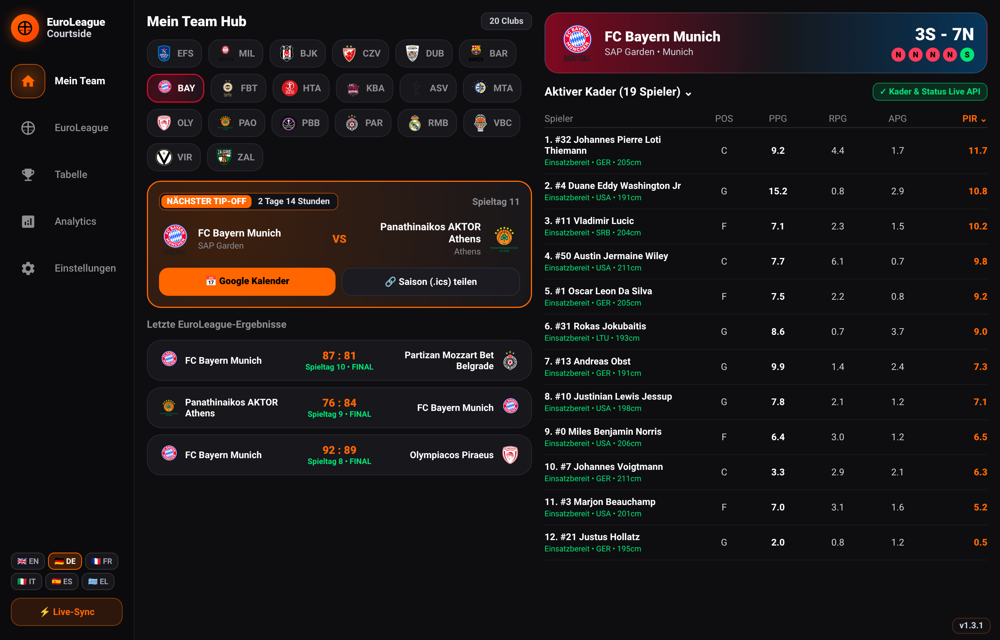
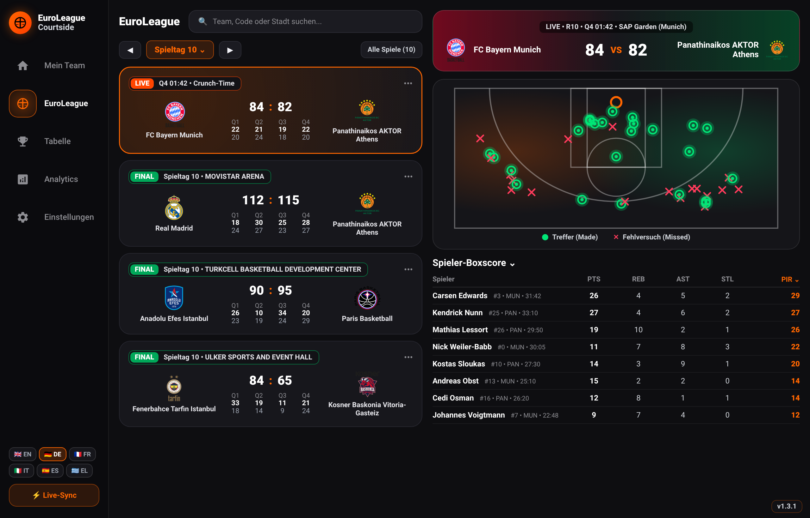
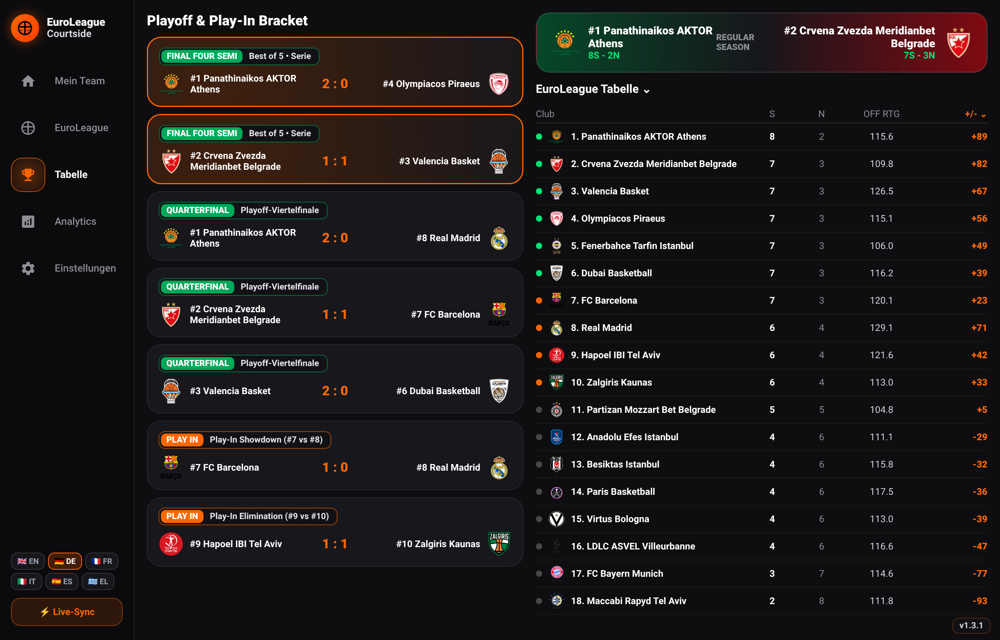
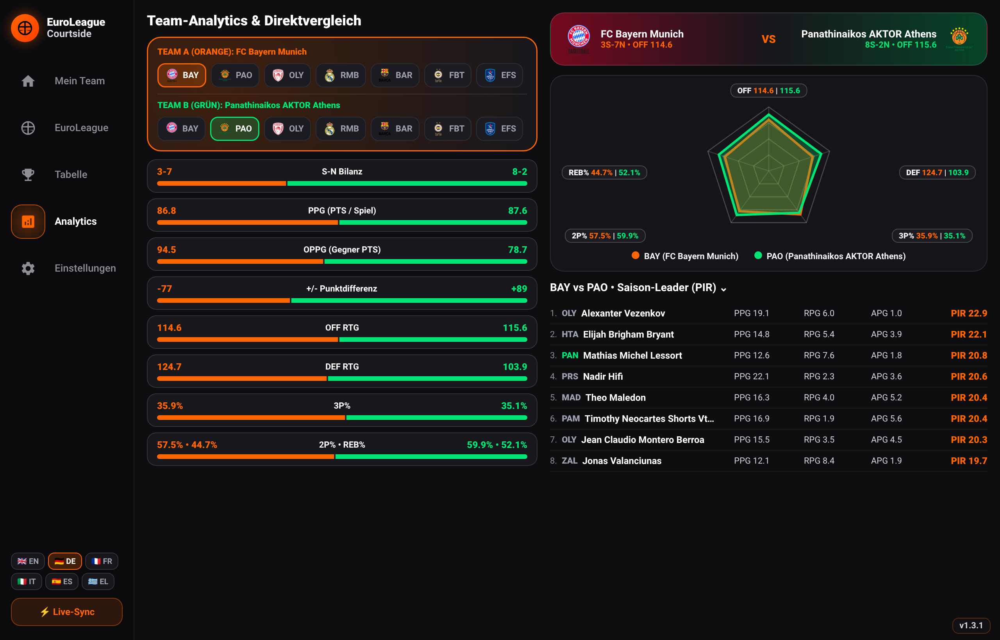
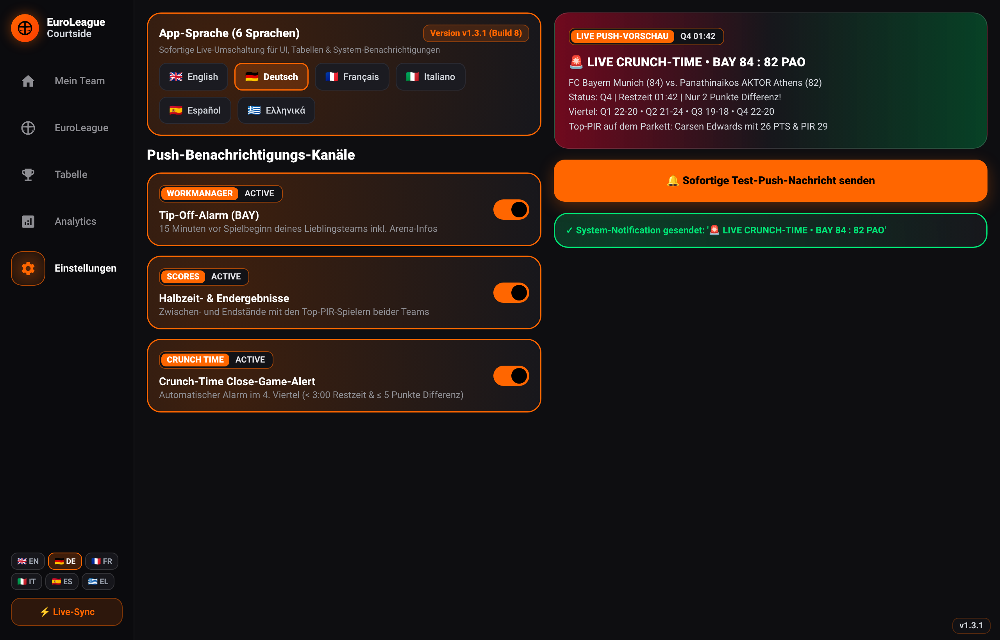

# 🏀 EuroLeague Courtside

**EuroLeague Courtside** ist eine vollständig native Kotlin- & Jetpack-Compose-App (Material 3 Adaptive) im modernen **Courtside UI Broadcast-Design** für **Googlebook OS (Desktop/Laptop)**, **Android-Tablets**, **Foldables (Falt-Handys)** und **Smartphones**.

---

## 📸 High-Resolution Screenshots (`2560 × 1640` Retina)

### 1. Mein Team Hub (Standard-Startansicht – immer beim App-Start)
Beim Öffnen der App startet **EuroLeague Courtside** ausnahmslos im **Mein Team Hub** (`CourtsideDestination.MY_TEAM`) mit Vereins-Umschalter (alle 20 EuroLeague-Clubs inkl. offizieller Wappen), **Nächster Tip-Off Countdown** (`Tage & Stunden`), direktem **Google Kalender / `.ics` Saison-Export** sowie dem live verifizierten **Aktiven Kader** sortiert nach **PIR**.

---

### 2. Live Match-Center, Half-Court Shot-Chart & PIR-Boxscore
Zweispaltiges Broadcast-Split-View (`ListDetailPaneScaffold`): Links die Spieltags-Übersicht (alle **38 Spieltage / 380 Spiele**) mit Schnellsuche, `[LIVE | Q4 01:42]`-Badges und Viertel-Matrix; rechts gleichzeitig das **Dual-Tone-Scoreboard**, das interaktive **Half-Court Shot-Chart** (`Made` in `#00E676`, `Missed` in `#FF3B5C`) und der sortierbare **Spieler-Boxscore** mit offizieller EuroLeague-**PIR**-Berechnung.

---

### 3. EuroLeague Tabelle & Playoff / Play-In Bracket
Echtzeit-Projektion des **Final Four**, der **Playoff-Viertelfinals** (`#1–#6`, grün markiert) und des **Play-In Showdowns** (`#7–#10`, orange markiert) auf Basis der realen Regular-Season-Direktvergleiche neben der vollständigen EuroLeague-Tabelle.

---

### 4. Team-Analytics, 5-Achsen-Radar & Saison-Leader
Frei wählbarer Head-to-Head-Teamvergleich (**Team A** in Orange vs. **Team B** in Grün) mit 8 visuellen Statistik-Vergleichsbalken (`S-N`, `PPG`, `OPPG`, `+/- Diff`, `OFF RTG`, `DEF RTG`, `3P%`, `2P% • REB%`), beschriftetem **5-Achsen-Radar-Chart** (Compose `Canvas`) und den aktuellen **PIR-Saison-Leadern**.

---

### 5. 6-Sprachen-Lokalisierung & Push-Notification-Studio
Komplette Live-Lokalisierung in **6 Sprachen (`🇬🇧 EN`, `🇩🇪 DE`, `🇫🇷 FR`, `🇮🇹 IT`, `🇪🇸 ES`, `🇬🇷 EL`)** für das gesamte UI sowie alle System-Benachrichtigungen (**Tip-Off-Alarm**, **Halbzeit-/Endergebnisse**, **Crunch-Time Close-Game-Alert**) inklusive sofortigem **Test-Push-Button**.

---

## ✨ Features & Architektur

### 1. Courtside UI Design & Offizielle Vereinswappen/-farben
- **Obsidian Broadcast-Design (`#0E0E11` / `#17171C`)** mit warmem EuroLeague-Orange-Glow (`#FF6600`) und Dual-Tone-Verlaufs-Bannern.
- **Immer „My Team“ beim Start:** Kaltstart, Prozess-Wiederherstellung, Warmstart aus dem Hintergrund und Launcher-/Notification-Aufrufe öffnen zuverlässig immer den **Mein Team Hub**, wobei das gewählte Lieblingsteam dauerhaft gespeichert bleibt.
- **Alle EuroLeague-Clubs** mit ihren offiziellen Primär-, Sekundär- und Akzentfarben sowie offiziellen Vereinswappen (`CourtsideClubCrest` in `CourtsideTheme.kt`).
- **Touch- & Desktop-Ergonomie:** Garantierte `48.dp` Touch-Targets kombiniert mit Maus-Hover-Effekten (`Modifier.hoverable()`), `PointerIcon.Hand`, Rechtsklick-Kontextmenü (`isSecondaryPressed`) und Hintergrund-Tastatur-Shortcuts (`Ctrl/Cmd + 1–5`, `F`, `R`, `←`/`→`).

### 2. Adaptives Multi-Device-Layout & Foldables
- **Desktop & Expanded Screens (Googlebook OS):** Linke Broadcast-Sidebar (`CourtsideLeftSidebar`) + mehrspaltiges Dual-Pane Split-View (`ListDetailPaneScaffold`).
- **Foldables (`BookPosture` & `TableTopPosture`):** Automatische Scharnier-Erkennung über Jetpack `WindowInfoTracker` (`FoldingFeature`).
- **Smartphones (`COMPACT`):** Abgedunkelte `NavigationBar` am unteren Bildschirmrand.

### 3. Live-Match-Center, PIR-Boxscore & Compose Canvas Charts
- **Split-View Match-Center (`MatchCenterScreen.kt`):**
  - Links: Live-Spielkarten mit `[LIVE | Q4 01:42]`-Badge, Vereinswappen und `Q1 Q2 Q3 Q4`-Matrix über alle 38 Spieltage.
  - Rechts (gleichzeitig sichtbar): Dual-Tone-Scoreboard + leuchtendes **Half-Court Shot-Chart** (`Made` in `#00E676`, `Missed` in `#FF3B5C`) + sortierbare **`Player boxscore ⌄`**-Tabelle mit offizieller EuroLeague-**PIR**-Berechnung.
- **Team-Radar-Vergleich:** Nativ mit Compose `Canvas` gezeichnetes, beschriftetes 5-Achsen-Radar-Chart (`OFF`, `DEF`, `3P%`, `2P%`, `REB%`).

### 4. Zwei Native Kalender-Export-Wege (`CalendarExportHelper.kt`)
1. **Google Kalender System-Intent:** `Intent(Intent.ACTION_INSERT)` mit `CalendarContract.Events.CONTENT_URI`, Arena als `EVENT_LOCATION` und 30-Minuten-Reminder.
2. **RFC 5545 `.ics` Saison-Generator:** Erzeugt eine standardkonforme `.ics`-Datei inkl. `VALARM` (`-PT30M`) für alle Saisonspiele des Lieblingsteams und teilt sie über `FileProvider`.

### 5. Natives Benachrichtigungs-System in 6 Sprachen (`EuroLeagueNotificationManager.kt`)
- Dedizierte `NotificationChannel`s für **Tip-Off-Alarme** (15 Min. vor Spielbeginn via `WorkManager`), **Halbzeit-/Endergebnisse** und **Crunch-Time Close-Game-Alerts** (Q4 `< 3:00` Restzeit bei `<= 5` Punkten Differenz) – vollständig lokalisiert in `EN`, `DE`, `FR`, `IT`, `ES` und `EL`.
- Integrierter **Test-Push-Button** im Einstellungs-Tab mit `NotificationCompat.BigTextStyle`.

---

## 🛠️ Tech-Stack
- **UI:** 100 % Kotlin, Jetpack Compose, Material 3 Adaptive (`ListDetailPaneScaffold`), Jetpack WindowManager (`androidx.window:window`)
- **Architektur:** Clean Architecture, MVVM / MVI (`CourtsideViewModel`), Kotlin Coroutines & `StateFlow`, Hilt DI
- **Persistenz & Netzwerk:** Room Database (`CourtsideDatabase`), Jetpack DataStore & Quick-Boot SharedPreferences (`CourtsidePreferencesDataStore`), Retrofit + Kotlinx Serialization (`EuroLeagueApiService`)
- **CI/CD:** GitHub Actions Workflow (`.github/workflows/android-build.yml`) führt bei jedem Push automatisch die Unit-Tests aus, baut das signierte Release- & Debug-APK und veröffentlicht es unter [GitHub Releases](https://github.com/petrosvassiliou/euroleague-courtside/releases).
